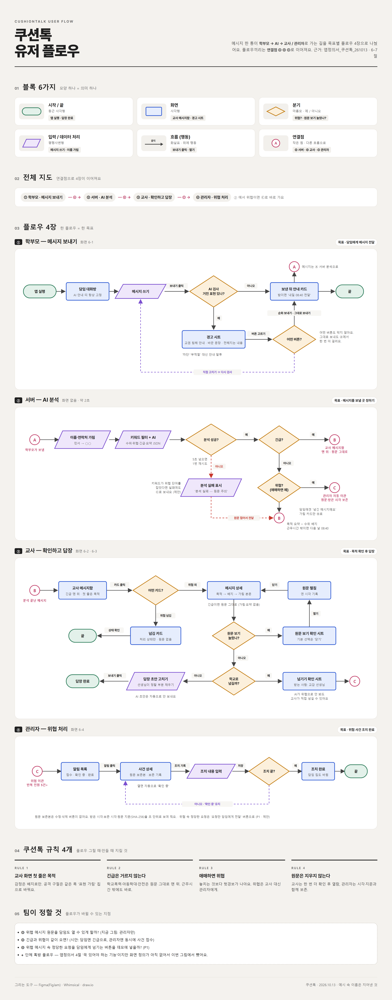

# 쿠션톡 (CushionTalk)

학부모가 보낸 메시지를 **AI가 먼저 읽고**, 공격적 표현은 가리고 **목적만** 교사에게 보여 주는 앱.

기술 스택: React (모바일 화면 기준 웹) · Python FastAPI · SQLite · LLM

## 유저 플로우



메시지 한 통이 학부모 → AI → 교사 / 관리자로 가는 길을 4장으로 나눴어요. 원본: [docs/유저플로우_쿠션톡_261013.html](docs/유저플로우_쿠션톡_261013.html)

## 폴더 구조

```
Adventure-Design/
├─ docs/                # 앱정의서, 유저 플로우
├─ git-practice/        # 브랜치·커밋·푸시·풀 연습용 (연습 끝나면 삭제)
├─ backend/
│  └─ app/
│     ├─ ai/            # AI 분석 (이름 가림 → 키워드 필터 → LLM → 긴급/위협 분기)
│     └─ api/           # API (메시지, 보내기 전 검사, 관리자 이관)
└─ frontend/
   └─ src/
      ├─ pages/         # 화면 (학부모 작성, 교사 메시지함·상세, 관리자)
      └─ components/    # 공통 부품 (배지, 버튼, 확인 창)
```

## 역할

| 역할 | 담당 |
|---|---|
| 팀장 | `docs/`, PR 리뷰, 일정 |
| 풀스택 | 관리자 화면 (프론트+백엔드), 프론트↔백엔드 연결 |
| 백엔드 A | `backend/app/ai/` |
| 백엔드 B | `backend/app/api/`, DB |
| 프론트 A | 학부모 화면, `components/` |
| 프론트 B | 교사 메시지함·상세 |

## 브랜치 규칙

- `main`에 직접 push 금지, PR로만 머지
- 브랜치 이름: `feat/기능이름` (예: `feat/teacher-inbox`)
