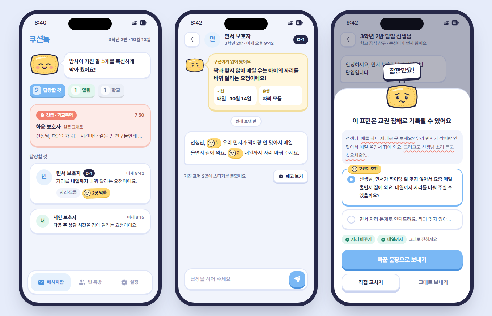
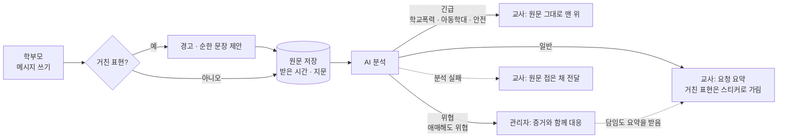
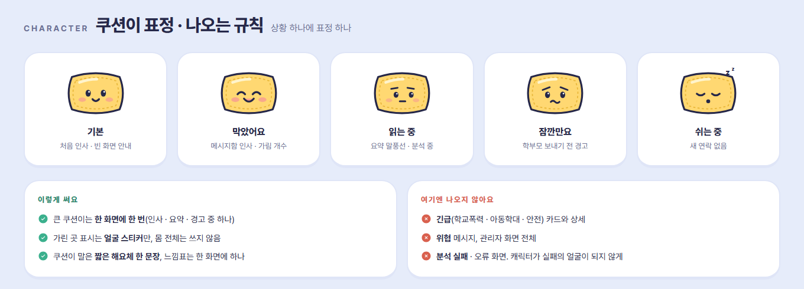

# 쿠션톡 (CushionTalk)

**학부모 메시지를 AI가 먼저 읽고, 교사에게는 요청만 전해 주는 학교 소통 앱**

공격적인 표현은 가리고, 요청은 하나도 빼지 않아요. 위협은 교사 혼자가 아니라 학교가 받아요.



> 지금은 **설계 단계**예요. 위 화면은 확정 디자인 시안(E2)이고, 기획 · 화면 · DB · API 문서까지 마쳤어요. 개발은 이제 시작해요. ([진행 상황](#진행-상황))

---

## 왜 만드나

2026년 3월부터 학부모 연락이 학교 공식 플랫폼으로 모였지만, 메시지는 걸러지지 않고 그대로 교사에게 가요. 교사는 요청을 알기 위해 모욕적인 말까지 끝까지 읽어야 하고, 이런 일이 쌓이면 직무 스트레스와 교권 침해로 이어져요.

| 지금 | 쿠션톡에서는 |
|---|---|
| 메시지를 걸러 주는 장치가 없다 | **AI 완충** — AI가 먼저 읽고 공격적인 표현을 가린 **요청 요약**만 보여 줘요 |
| 수신을 끄면 다 막히고, 켜면 다 받는다 | **표현만 거름** — 요청은 그대로. 교사는 원하면 언제든 [원문 보기] |
| 위협을 교사 혼자 감당한다 | **위협 자동 이관** — 관리자(교감 · 민원대응팀)에게 넘기고 원문을 시간과 함께 보존 |
| 보내는 쪽에 멈출 계기가 없다 | **보내기 전 경고** — “이 표현은 교권 침해로 기록될 수 있어요” + 순한 문장 제안 |
| 반 단톡방을 만들면 개인 메신저가 노출된다 | **앱 안 반 톡방** — 참여 코드로 학생을 부르고, 교사 개인 계정은 보이지 않아요 |

## 메시지 한 통이 가는 길



- **저장이 분석보다 먼저**예요. 원문과 서버 시간을 먼저 남기고, 원문은 고치거나 지울 수 없어요 (SHA-256 지문으로 확인).
- 긴급 메시지는 요약하면 대응이 늦어질 수 있어서 **가리지 않고 원문 그대로** 보여 줘요.
- 교사 답장, 반 톡방 메시지는 AI를 거치지 않아요.

## 누가 무엇을 하나

| 사람 | 들어오는 법 | 할 수 있는 일 |
|---|---|---|
| **학부모** | 아이디 · 비밀번호 (가입할 때 학교 검색) | 선생님 목록에서 담임 고르기 · 유형(상담 · 결석·조퇴 · 자리·모둠 · 학습 · 생활 · 기타)과 기한을 골라 메시지 보내기 · 답장 보기 |
| **교사** (담임) | 아이디 · 비밀번호 | 요약으로 메시지 확인 · 필요할 때만 원문 보기 · 답장 · 반 톡방 열기 · 참여 코드 발급 |
| **관리자** (교감 · 민원대응팀) | 아이디 · 비밀번호 | 위협 메시지를 원문 · 받은 시간 · 지문 · AI 판단 이유와 함께 보기 · 대응 기록(면담 · 교육청 보고 · 수사기관 신고) · 일반 메시지로 되돌리기 |
| **학생** | 참여 코드 + 이름 (로그인 없음) | 반 단체 톡방에서 담임 · 친구들과 대화 |

## 쿠션이

쿠션톡의 마스코트예요. 상황마다 정해진 표정 하나만 쓰고, **긴급 · 위협 · 분석 실패 화면과 관리자 화면에는 나오지 않아요.**



## 화면 (와이어프레임 26장)

| 플로우 | 화면 |
|---|---|
| G 로그인 · 가입 | 로그인 · 학부모 가입(학교 검색) |
| A 학부모 | 선생님 목록 · 작성 · 보내기 전 검사 · 경고 시트 · 직접 고치기 · 보낸 뒤 |
| C 교사 | 메시지함(답장할 것 · 알림 · 학교) · 새 연락 없음 · 상세(일반 · 긴급 · 위협 · 분석 실패) · 원문 시트 |
| D 관리자 | 위협 알림 · 위협 상세와 대응 기록 · 처리 완료 |
| E 교사 반 톡방 | 반 톡방 목록 · 참여 코드(처음 발급 · 다시 보기 · 재발급) · 단체 톡방 |
| F 학생 | 톡방 참여 · 코드 만료/틀림 · 단체 톡방 |

화면 배치는 [와이어프레임](docs/03_화면/와이어프레임_쿠션톡_261016.html), 색 · 부품은 [컴포넌트 명세](docs/03_화면/컴포넌트명세_쿠션톡_261016.html)에 있어요.

## 만드는 방법

| 부분 | 기술 | 설계 |
|---|---|---|
| 화면 | React (모바일 화면 기준 웹) | 화면 26장 · 부품 21개 |
| 서버 | Python FastAPI | API 28개 · 토큰 로그인 · 10초마다 새 소식 확인 |
| DB | SQLite | 테이블 13개 · 원문 잠금 트리거 → [`schema.sql`](backend/app/db/schema.sql) |
| AI | LLM | 이름 가림 → 키워드 필터 → LLM → 긴급 / 위협 분기 · 5초 넘으면 1번 재시도 |

## 진행 상황

- [x] 서비스 정의서 (10.15)
- [x] 유저플로우 · 와이어플로우 (10.16 → 11.02 로그인 · 가입 추가)
- [x] 디자인 시안 E2 확정 · 와이어프레임 26장 · 컴포넌트 명세 (10.16 → 11.02)
- [x] DB 설계 확정 (11.02)
- [x] API 명세 초안 (11.02)
- [ ] Todo 분담표
- [ ] 백엔드: DB · API · AI 분석
- [ ] 프론트: 공통 부품 → 화면
- [ ] 연결 · 시연

## 문서

`docs/index.html`이 목차예요. 앞 문서가 뒤 문서의 근거라서 이 순서로 읽으면 돼요. HTML 문서는 GitHub에서 글자로만 보이니, 레포를 받은 뒤 브라우저로 열어 주세요.

| 순서 | 문서 | 내용 |
|---|---|---|
| 1 | [서비스 정의서](docs/01_기획/서비스정의서_쿠션톡_261015.md) | 누가 · 왜 · 무엇을. 기능 범위의 기준 |
| 2 | [유저플로우](docs/02_흐름/유저플로우_쿠션톡_261015.md) ([흐름도](docs/02_흐름/유저플로우_쿠션톡_261015.html)) | 플로우 7개. 6 · 7절에 정한 것 |
| 3 | [와이어플로우](docs/02_흐름/와이어플로우_쿠션톡_261016.html) | 흐름 위에 화면을 얹은 것 |
| 4 | [와이어프레임](docs/03_화면/와이어프레임_쿠션톡_261016.html) | 화면 26장의 배치와 부품 |
| 5 | [컴포넌트 명세](docs/03_화면/컴포넌트명세_쿠션톡_261016.html) | 부품 21개 · 디자인 토큰 · 만드는 순서 (시안 [E2](docs/04_디자인시안/E2_쿠션이_다듬기.html)) |
| 6 | [DB 설계](docs/05_데이터/DB설계_쿠션톡_261017.html) | 테이블 13개 · ERD · 원문 보관 규칙 |
| 7 | [API 명세](docs/06_API/API명세_쿠션톡_261102.html) | API 28개 · 오류 코드 · AI 분석 계약 · 화면별 API |

## 폴더 구조

```
Adventure-Design/
├─ docs/                # 목차(index.html)와 기획 · 흐름 · 화면 · 시안 · 데이터 · API 문서
│  ├─ images/           # README 그림
│  └─ 보관/             # 지난 문서 (10.13 앱정의서 · 유저 플로우)
├─ git-practice/        # 브랜치·커밋·푸시·풀 연습용 (연습 끝나면 삭제)
├─ backend/
│  └─ app/
│     ├─ ai/            # AI 분석 · API 명세 05절
│     ├─ api/           # API · API 명세 03절
│     └─ db/            # schema.sql (DB 설계 07절 생성문)
└─ frontend/
   └─ src/
      ├─ pages/         # 화면 · 와이어프레임 26장
      └─ components/    # 공통 부품 · 컴포넌트 명세
```

## 팀

| 역할 | 담당 |
|---|---|
| 팀장 | `docs/`, PR 리뷰, 일정 |
| 풀스택 | 관리자 화면 (프론트+백엔드), 프론트↔백엔드 연결 |
| 백엔드 A | `backend/app/ai/` |
| 백엔드 B | `backend/app/api/`, DB |
| 프론트 A | 학부모 화면, `components/` |
| 프론트 B | 교사 메시지함·상세 |

로그인 · 가입(G)과 반 톡방(E · F) 화면 담당은 Todo 분담표에서 정해요.

**규칙** — 자세한 건 [Git · GitHub 규칙](docs/바이브코딩%20협업표/Git_GitHub_규칙.md)

- `main`에 직접 push 금지, PR로만 머지
- 브랜치: `종류/산출물ID-짧은-설명` (예: `feat/T1-MJ-login-page`, 작은 수정은 `docs/etc-fix-typo`)
- 커밋: `종류: 무엇을 했는지` (예: `docs: API 명세에 오류 코드 추가`)
