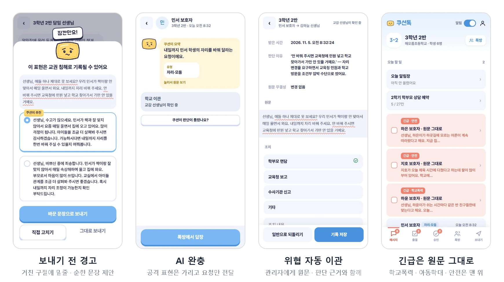
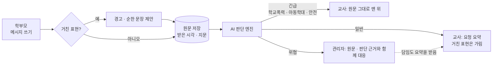

# 쿠션톡 (CushionTalk)

**거친 표현은 거르고, 의도만 전달해 주는 학교 소통 플랫폼**

학부모가 보낸 메시지를 AI가 먼저 읽습니다. 공격적인 표현은 가리고 요청만 담임교사에게 전하며, 위협은 교사 혼자가 아니라 학교가 함께 받습니다.



---

## 왜 만들었나

2023년 서이초 사건 이후 교권보호법이 바뀌고, 교사 개인 연락처 대신 공식 창구로 민원을 받는 제도가 생겼습니다. 그래도 학부모 악성 민원은 여전히 교권 침해의 가장 큰 원인이고, 대부분은 교사 혼자 감당합니다.

- 초등교사 **99%**가 교권 침해를 겪었다고 답했고, 가장 큰 원인은 학부모 악성 민원이었습니다 (2023 초등교사노조 설문).
- 교권 침해를 겪고도 실제 신고까지 간 경우는 **약 4%**였습니다 (교총 조사). 보복 민원이 두려웠기 때문입니다.
- 공식 온라인 창구 이어드림은 상담 기능을 켠 학교가 **3.9%**뿐이고, 학급 소통 앱의 수신 차단 기능은 긴급 연락까지 막습니다.

기존 서비스는 **연락처를 가리는 데**에 집중했습니다. 쿠션톡은 교사가 공격적인 말에 계속 노출되는 문제를 **메시지 단계에서** 줄이는 데 집중합니다.

## 핵심 기능

| 기존 방식의 한계 | 쿠션톡의 해결 |
|---|---|
| 공격적인 메시지를 걸러 주는 장치가 없다 | **AI 완충**: AI가 먼저 읽고, 공격 표현을 가린 **요청 요약**만 교사에게 보여 줍니다 |
| 연락을 다 받거나 다 막는 선택뿐이다 | **표현만 거르기**: 요청은 하나도 빼지 않고 전합니다. 교사는 필요할 때 [원문 보기]로 확인합니다 |
| 공격적인 민원을 교사가 혼자 대응한다 | **위협 자동 이관**: 위협 메시지는 교감 · 민원대응팀에게 넘어가고, 원문과 받은 시각을 고칠 수 없게 보존합니다 |
| 보내는 쪽에 멈출 계기가 없다 | **보내기 전 경고**: 거친 구절에 밑줄을 긋고, 같은 요청을 담은 순한 문장 두 가지를 제안합니다 |

그 밖에 긴급 메시지(학교폭력 · 아동학대 · 안전)는 순화하지 않고 원문 그대로 맨 위에 보여 주며, 교사가 알림을 꺼도 긴급 연락은 남습니다. 출결 알림, 체험학습 신청 · 승인, 알림장 확인 현황, 상담 예약, 반 단체 톡방도 앱 안에서 처리합니다.

## 메시지 한 통이 가는 길



- **저장이 분석보다 먼저**입니다. 원문과 서버 시각을 먼저 남기고, 원문은 고치거나 지울 수 없습니다 (DB 트리거 · SHA-256 지문).
- 교사 답장과 반 톡방 메시지는 AI를 거치지 않습니다.
- 교사가 "판단이 틀렸나요?"를 누르면 그 피드백은 다시 학습할 데이터로 모입니다.

## AI 판단 엔진

외부 API에 판단을 맡기면 학부모 · 학생 메시지 원문이 밖으로 나가고, 메시지마다 비용과 수 초의 지연이 생기며, 모호한 표현에서 결과가 흔들립니다. 그래서 **판단은 서버 안에서 직접 학습시킨 앙상블 모델**이 합니다.

```
메시지 ─▶ 문장 단위 + 이웃한 두 문장 묶음으로 나누기
              │
              ├─ ① 키워드 규칙
              ├─ ② BERT 분류기   (smilegate-ai/kor_unsmile을 교사 LLM 라벨로 증류 학습)
              └─ ③ kNN 의미 검색 (학습 문장 중 가장 비슷한 7개의 투표)
              ▼
         라벨마다 로지스틱 회귀로 합치기 → 거침 · 위협 · 긴급
```

판단기끼리 의견이 갈리면 합친 점수가 정합니다. 요약과 순한 문장 쓰기는 이름을 바꾸고 거친 구절을 가린 뒤 충남대 AI 포털 API에 맡깁니다.

**성능** (학습에 쓰지 않은 평가 문항 964개, 로컬 판단 엔진만)

| 지표 | 공개 모델 + 키워드 | 쿠션톡 |
|---|---|---|
| 거친 표현 F1 | 0.485 | **0.966** |
| 위협 재현율 | 0.06 | **0.91** |
| 긴급 재현율 | 0.18 | **0.92** |

메시지 한 통 판단에 약 50ms가 걸립니다. 평가 문항은 합성 문장이라 실제 학부모 메시지에서는 더 낮을 수 있습니다. 자세한 구조와 재학습 방법은 [ml/README.md](ml/README.md), 결과는 [ml/results_big.md](ml/results_big.md)에 있습니다.

## 누가 무엇을 하나

| 사용자 | 들어오는 법 | 할 수 있는 일 |
|---|---|---|
| **학부모** | 카카오 · 구글 · 아이디 로그인 | 담임에게 메시지 보내기 (보내기 전 경고), 출결 알리기, 체험학습 신청, 상담 예약, 알림장 확인 |
| **담임교사** | 카카오 · 구글 · 아이디 로그인 (학교 관리자 승인 뒤) | 요청 요약으로 메시지 확인, 필요할 때 원문 보기, 답장, 알림 끄기, 반 톡방 운영 |
| **관리자** (교감 · 민원대응팀) | 카카오 · 구글 · 아이디 로그인 (승인 뒤) | 위협 메시지를 원문 · 받은 시각 · 판단 이유와 함께 확인, 조치 기록(면담 · 교육청 보고 · 수사기관 신고), 가입 승인 |
| **학생** | 참여 코드 + 이름 (로그인 없음) | 반 단체 톡방, 담임과 1:1 대화 |

교사와 관리자 계정은 학교 관리자가 승인해야 쓸 수 있습니다. 외부인이 교사나 관리자로 들어와 민원 기록을 보는 일을 막기 위해서입니다.

## 기술 스택

| 부분 | 기술 |
|---|---|
| 프론트엔드 | React 19 + Vite (모바일 화면 기준 웹) |
| 백엔드 | Python FastAPI, 토큰 로그인, 카카오 · 구글 OAuth |
| DB | SQLite (원문 수정 · 삭제를 막는 트리거) → [`schema.sql`](backend/app/db/schema.sql) |
| AI | PyTorch · Transformers (로컬 판단 엔진), 충남대 AI 포털 API (요약 · 순한 문장) |

## 실행하기

필요한 것: **Python 3.12**, **Node.js**

**Windows**는 레포 맨 위의 `실행.bat`을 더블클릭하면 됩니다. 처음이면 설치까지 하고, 서버 창 두 개(백엔드 · 프론트)가 뜬 뒤 브라우저가 열립니다. 두 창은 닫지 말고 두세요.

직접 켜려면 처음 한 번 설치합니다.

```bash
cd backend && python -m venv .venv && .venv/Scripts/python -m pip install -r requirements.txt
```

```bash
cd frontend && npm install
```

그다음 서버 두 개를 각각 켜고 http://localhost:5173 을 엽니다 (휴대폰 폭으로 보면 좋습니다).

```bash
cd backend && .venv/Scripts/python -m uvicorn app.api.main:app --reload
```

```bash
cd frontend && npm run dev
```

- macOS · Linux에서는 `.venv/Scripts/python` 대신 `.venv/bin/python`을 씁니다.
- 처음 켜면 `backend/cushion.db`가 만들어지고 체험용 예시 데이터가 들어갑니다. 처음 상태로 돌리려면 이 파일을 지우고 다시 켭니다.
- 예시 계정은 비밀번호가 모두 `pass1234`입니다: 교사 `teacher1` · 관리자 `admin1` · 학부모 `parent1`~`parent6` · 학생 `student1`~`student6`. 시작 화면의 "개발용 테스트 계정으로 들어가기"로 바로 들어갈 수 있습니다.
- 소셜 로그인 앱 키가 없으면 소셜 버튼은 이름만 넣는 데모 로그인으로 동작합니다.
- API 문서는 서버를 켠 뒤 http://localhost:8000/docs 에서 볼 수 있습니다.

**AI 판단 엔진까지 켜기** (선택, 켜지 않으면 키워드 규칙으로 동작합니다)

1. `backend/.env.example`을 `backend/.env`로 복사하고 `CNU_API_KEY=`에 충남대 AI 포털 키를 넣습니다.
2. AI 패키지를 설치합니다 (약 2GB, 처음 한 번).
   ```bash
   cd backend && .venv/Scripts/python -m pip install -r requirements-ai.txt --extra-index-url https://download.pytorch.org/whl/cpu
   ```
3. 학습된 모델(`ml/models/judge`, 약 440MB)은 레포에 없습니다. `ml/train.py`로 만들거나 팀에서 받아 넣습니다 ([ml/README.md](ml/README.md)).

## 폴더 구조

```
Adventure-Design/
├─ frontend/src/
│  ├─ pages/          # 역할별 화면 (로그인 · 학부모 · 교사 · 관리자 · 학생 · 반 톡방 · 편의 기능)
│  └─ components/     # 공통 부품
├─ backend/app/
│  ├─ api/            # FastAPI 서버 · 로그인 · 예시 데이터
│  ├─ ai/             # 메시지 판단 (analyzer.py · judge.py)
│  └─ db/             # schema.sql
├─ ml/                # 판단 엔진 학습 · 평가 (데이터 · 스크립트 · 결과)
├─ docs/              # 설계 문서: 1_기획 · 2_사용자흐름 · 3_화면디자인 · 4_시스템설계 · 5_AI
└─ 실행.bat           # Windows 한 번에 켜기
```

## 문서

설계 문서는 단계별 폴더로 나뉘어 있고, 안내는 [docs/README.md](docs/README.md)에 있습니다. HTML 문서는 GitHub에서 글자로만 보이니 레포를 받은 뒤 [docs/index.html](docs/index.html)을 브라우저로 열어 주세요.

| 문서 | 내용 |
|---|---|
| [서비스 정의서](docs/1_기획/서비스정의서.md) | 누가 · 왜 · 무엇을 |
| [유저플로우](docs/2_사용자흐름/유저플로우.md) · [와이어플로우](docs/2_사용자흐름/와이어플로우.html) | 사용자별 흐름과 화면 사이 연결 |
| [와이어프레임](docs/3_화면디자인/와이어프레임.html) · [컴포넌트 명세](docs/3_화면디자인/컴포넌트명세.html) · [디자인 시안 E2](docs/3_화면디자인/디자인시안_E2.html) | 화면 배치와 디자인 |
| [DB 설계](docs/4_시스템설계/DB설계.html) | 테이블 · ERD · 원문 보관 규칙 |
| [API 명세](docs/4_시스템설계/API명세.html) | API · 오류 코드 · AI 분석 계약 |
| [AI 실험 계획](docs/5_AI/AI실험계획.html) | 판단은 로컬 모델, 작성은 API로 나눈 이유 |

---

어드벤처디자인 2026-2학기 · 나중에 정해조
