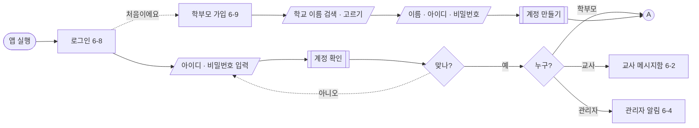
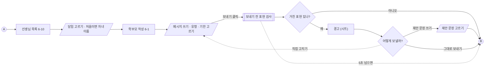
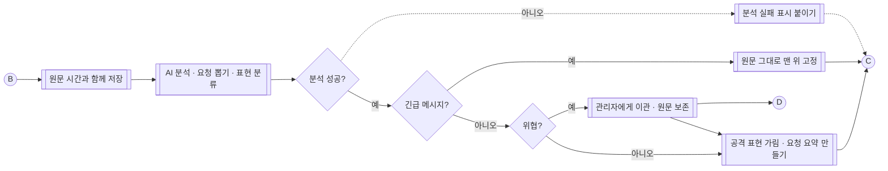
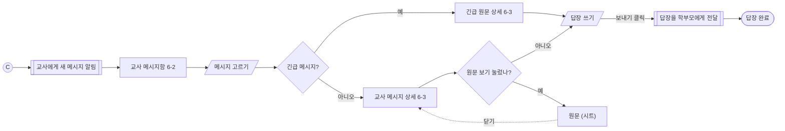
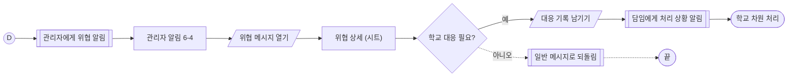
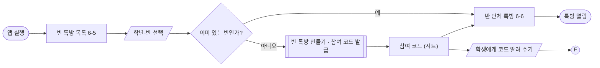
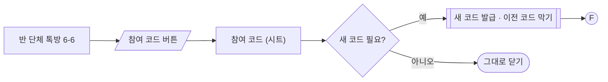
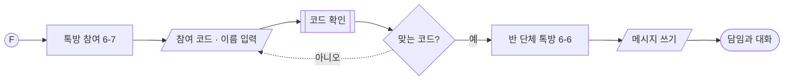

# [26.10.15] 쿠션톡 유저 플로우

> 근거 문서: `서비스정의서_쿠션톡_261015.md` · 화면 번호: `앱정의서_쿠션톡_6-7절_261013.html`
> 26.10.16 수정: 미정 6개 결정 반영 (6절)
> 26.11.02 수정: DB 설계 결정 반영 — Ⓖ 로그인 · 가입 추가, 선생님 목록, 유형 · 기한 고르기 (7절)

## 0. 그리기 전에

블록 모양과 선의 뜻은 `바이브코딩 협업표/유저플로우_블록정의.md`를 확인하고 그대로 따른다.

| 블록 | Mermaid | 뜻 |
|---|---|---|
| 둥근 사각형 | `([ ])` | 시작 / 끝 |
| 사각형 | `[ ]` | 화면 (시트는 이름 뒤에 `(시트)`) |
| 평행사변형 | `[/ /]` | 사용자 입력 |
| 양옆 세로줄 사각형 | `[[ ]]` | 시스템 처리 |
| 마름모 | `{ }` | 분기 |
| 작은 원 | `(( ))` | 연결점 |
| 실선 / 점선 | `-->` / `-.->` | 기본 흐름 / 되돌아가기·실패·예외 |

## 1. 전체 지도

```text
Ⓖ 로그인 · 가입 ──▶ Ⓐ (학부모) · Ⓒ (교사) · Ⓓ (관리자) · Ⓔ (교사)

Ⓐ 학부모 · 메시지 보내기 ── Ⓑ ──▶ Ⓑ 서버 · AI 분석 ── Ⓒ ──▶ Ⓒ 교사 · 확인하고 답장
                                          │
                                          └── Ⓓ ──▶ Ⓓ 관리자 · 위협 처리

Ⓔ 교사 · 반 톡방 만들기 ── Ⓕ ──▶ Ⓕ 학생 · 반 톡방 참여
```

| 연결점 | 뜻 |
|---|---|
| Ⓖ | 로그인 · 가입. 학부모 · 교사 · 관리자가 앱 실행에서 시작한다. 학생은 거치지 않는다 (Ⓕ). |
| Ⓐ | 학부모 플로우. 로그인(Ⓖ) 뒤 선생님 목록에서 시작한다. |
| Ⓑ | 서버 플로우. 학부모가 보낸 메시지가 들어온다. |
| Ⓒ | 교사 플로우. 서버가 분석을 마친 메시지가 들어온다. |
| Ⓓ | 관리자 플로우. 서버가 위협으로 분류한 메시지가 들어온다. |
| Ⓔ | 교사 반 톡방 플로우. 앱 실행에서 시작한다. |
| Ⓕ | 학생 플로우. 교사가 알려 준 참여 코드로 들어온다. |

## 2. 플로우

### Ⓖ 로그인 · 가입 (26.11.02 추가)

- **목표:** 학부모 · 교사 · 관리자가 아이디 · 비밀번호로 들어온다. 학부모는 가입할 때 학교를 고른다.
- **관련 화면:** 6-8 로그인, 6-9 학부모 가입



**메모**

- 아이디 · 비밀번호는 학부모 · 교사 · 관리자만. 학생은 참여 코드와 이름으로 들어온다 (Ⓕ).
- 교사 · 관리자 계정은 학교가 만든다고 보고, 앱의 가입 화면은 학부모용만 둔다 (임시).
- 학교는 이름으로 검색해서 고른다.

### Ⓐ 학부모 — 메시지 보내기

- **목표:** 학부모의 요청이 담임에게 빠짐없이 보내진다. 거친 표현을 썼다면 보내기 전에 한 번 돌아본다.
- **관련 화면:** 6-10 선생님 목록, 6-1, 경고 (시트)



**메모**

- 경고 문구: "이 표현은 교권 침해로 기록될 수 있어요". 순한 문장을 하나 이상 제안한다.
- 경고를 무시해도 보낼 수 있다. 이유: 요청은 하나도 빼지 않는다. 표현은 서버(Ⓑ)에서 한 번 더 거른다.
- 경고를 무시하고 보낸 사실은 따로 기록하거나 교사·관리자에게 보여 주지 않는다. 이유: 공격적인 메시지를 그대로 보낸 것 자체가 경고를 무시한 것이고, 원문은 서버(Ⓑ)에 받은 시간과 함께 남는다.
- 보내기 전 검사가 5초 넘으면 검사 없이 보낸다.
- 선생님 목록은 학부모 학교의 반 · 담임. 처음 고를 때 자녀 이름을 적고, 다음부터는 바로 그 담임 대화로 간다.
- 요청 유형(상담 · 결석·조퇴 · 자리·모둠 · 학습 · 생활 · 기타)은 꼭 고르고, 답장 기한은 고르지 않아도 된다.

### Ⓑ 서버 — AI 분석

- **목표:** 메시지를 긴급 · 위협 · 일반으로 나누고, 공격적인 표현을 가린 요청 요약을 만든다.
- **관련 화면:** 없음 (화면 밖 처리)



**메모**

- 분석보다 저장이 먼저다. 원문은 받은 시간과 함께 남기고 지우지 않는다.
- 분석이 5초 넘으면 1번 재시도. 또 실패하면 원문을 접은 채 '분석 실패' 표시로 교사에게 보낸다.
- 긴급 기준: 학교폭력 · 아동학대 · 안전. 요약하면 대응이 늦어질 수 있어 원문 그대로 보낸다.
- 애매한 표현은 위협으로 분류한다. 이유: 놓치는 것보다 한 번 더 확인하는 게 안전.
- 위협 메시지도 요청 요약은 담임에게 간다.
- 위협 원문은 담임도 볼 수 있다. 일반 메시지처럼 상세 화면(6-3)의 [원문 보기]로 연다.

### Ⓒ 교사 — 확인하고 답장

- **목표:** 교사가 공격적인 표현을 보지 않고 요청만 확인해 답장한다.
- **관련 화면:** 6-2, 6-3, 원문 (시트)



**메모**

- 메시지함은 긴급이 맨 위에 고정되고, 그 아래 일반 메시지가 온다. 긴급은 담임이 답장하면 맨 위에서 내려간다 (11.02).
- 위협 메시지에도 담임이 직접 답장할 수 있다 (11.02).
- 유형 · 기한은 학부모가 고른 값을 보여 준다 (AI가 뽑지 않음).
- 상세 화면은 요청 요약이 먼저다. 가린 표현은 개수만 보여 준다. 예: `거친 표현 3곳 가림`
- 위협 메시지는 상세 화면에 `학교로 넘겼어요` 표시가 붙는다. 원문은 [원문 보기]로 볼 수 있다.
- 교사 답장은 AI 검사를 거치지 않고 그대로 학부모에게 간다.

### Ⓓ 관리자 — 위협 처리

- **목표:** 교사 혼자가 아니라 학교가 위협 메시지에 대응한다.
- **관련 화면:** 6-4, 위협 상세 (시트)



**메모**

- 관리자: 교감 · 민원대응팀.
- 위협 상세에는 원문, 받은 시간, AI가 위협으로 본 이유를 함께 보여 준다.
- 대응 예: 학부모 면담, 교육청 보고, 수사기관 신고.
- 애매해서 위협으로 분류된 메시지는 여기서 사람이 한 번 더 걸러 낸다.
- 위협은 종류를 나누지 않고 "공격적 표현" 태그 하나로 보여 준다 (11.02).
- 대응 기록은 고치지 않고 덧붙이기만 한다 (11.02).

### Ⓔ 교사 — 반 톡방 만들기

- **목표:** 교사가 개인 메신저 없이 앱 안에 반별 학생 단체 톡방(예: 1-3반)을 연다.
- **관련 화면:** 6-5, 6-6, 참여 코드 (시트)



참여 코드 다시 보기 · 재발급



**메모**

- 교사의 개인 메신저 계정은 학생에게 보이지 않는다.
- 참여 코드는 반마다 하나.
- 참여 코드는 발급하고 하루(24시간) 동안 쓸 수 있다. 시트에 코드와 남은 시간을 함께 보여 준다.
- 재발급: 반 단체 톡방(6-6) 오른쪽 위 [참여 코드] 버튼 → 참여 코드 (시트) → [새 코드 받기]. 새 코드를 받으면 이전 코드는 바로 막힌다. 이미 들어온 학생은 그대로 남는다.

### Ⓕ 학생 — 반 톡방 참여

- **목표:** 학생이 참여 코드로 반 단체 톡방에 들어와 담임과 소통한다.
- **관련 화면:** 6-7, 6-6



**메모**

- 학생은 참여 코드와 이름만으로 들어온다. 학교 계정은 쓰지 않는다.
- 틀린 코드와 만료된 코드는 둘 다 "맞는 코드?"에서 아니오로 간다. 만료면 "코드가 만료됐어요. 선생님께 새 코드를 받아 주세요"라고 알린다.
- 학생 메시지는 AI 검사를 거치지 않는다.
- 다른 기기에서도 참여 코드와 이름으로 다시 들어온다. 같은 반에 같은 이름이 있으면 그 학생으로 이어 준다 (11.02).

## 3. 해결 방안과 플로우

서비스 정의서 4번의 해결 방안이 어느 플로우에 들어 있는지 정리한다.

| 해결 방안 | 플로우 | 블록 |
|---|---|---|
| AI 완충 | Ⓑ · Ⓒ | 공격 표현 가림 · 요청 요약 만들기 → 교사 메시지 상세 |
| 내용은 그대로, 표현만 거름 | Ⓐ · Ⓒ | 그대로 보내기 허용, 원문 (시트) |
| 위협 자동 이관 | Ⓑ · Ⓓ | 관리자에게 이관 · 원문 보존 |
| 보내기 전 경고 | Ⓐ | 보내기 전 표현 검사 → 경고 (시트) |
| 앱 안 반 단체 톡방 | Ⓔ · Ⓕ | 반 톡방 만들기 · 참여 코드 발급 |
| 긴급 메시지 원문 우선 표시 | Ⓑ · Ⓒ | 원문 그대로 맨 위 고정 → 긴급 원문 상세 |
| 애매한 표현은 위협으로 분류 | Ⓑ · Ⓓ | 위협? 분기, 일반 메시지로 되돌림 |

## 4. 화면 번호

| 번호 | 화면 | 누가 | 상태 |
|---|---|---|---|
| 6-1 | 학부모 작성 | 학부모 | 앱 정의서에 있음 |
| 6-2 | 교사 메시지함 | 교사 | 앱 정의서에 있음 |
| 6-3 | 교사 메시지 상세 (긴급이면 원문 상세) | 교사 | 앱 정의서에 있음 |
| 6-4 | 관리자 알림 | 관리자 | 앱 정의서에 있음 |
| 6-5 | 반 톡방 목록 | 교사 | 새 화면 · 번호 임시 |
| 6-6 | 반 단체 톡방 | 교사 · 학생 | 새 화면 · 번호 임시 |
| 6-7 | 톡방 참여 | 학생 | 새 화면 · 번호 임시 |
| 6-8 | 로그인 | 학부모 · 교사 · 관리자 | 11.02 새 화면 · 번호 임시 |
| 6-9 | 학부모 가입 (학교 검색) | 학부모 | 11.02 새 화면 · 번호 임시 |
| 6-10 | 선생님 목록 | 학부모 | 11.02 새 화면 · 번호 임시 |
| 시트 | 경고 · 원문 · 위협 상세 · 참여 코드 | — | 화면 블록에 `(시트)` 표시 |

## 5. 아직 정하지 않은 것

| 플로우 | 정할 것 |
|---|---|
| 공통 | 6-5 ~ 6-10 화면을 앱 정의서에 추가하고 번호 확정 |

## 6. 정한 것 (26.10.16)

| 플로우 | 질문 | 결정 |
|---|---|---|
| Ⓐ | 경고 무시 기록을 교사나 관리자에게 보여 주나? | 보여 주지 않는다. 공격적인 메시지를 그대로 보낸 것 자체가 경고를 무시한 것이다. `경고 무시 기록` 블록을 뺐다. |
| Ⓑ | 위협 원문을 담임도 볼 수 있나? | 볼 수 있다. 상세 화면(6-3)의 [원문 보기]로 연다. |
| Ⓒ | 교사 답장도 AI 검사를 거치나? | 거치지 않는다. |
| Ⓔ | 참여 코드 유효 기간과 재발급 방법 | 하루(24시간). 6-6 [참여 코드] 버튼 → 시트 → [새 코드 받기]로 재발급하고, 이전 코드는 바로 막는다. |
| Ⓕ | 학생 가입 방식: 참여 코드만 쓰나, 학교 계정을 쓰나? | 참여 코드와 이름만 쓴다. |
| Ⓕ | 학생 메시지도 AI 검사를 거치나? | 거치지 않는다. |

## 7. 정한 것 (26.11.02)

DB 설계 미정 항목을 정하면서 나온 결정. 흐름도(Ⓐ 앞에 Ⓖ 로그인 · 가입, 선생님 목록)와 와이어프레임에 반영했다.

| 플로우 | 질문 | 결정 |
|---|---|---|
| 공통 | 로그인 방식 | 학부모 · 교사 · 관리자는 아이디 · 비밀번호. |
| Ⓕ | 학생이 다른 기기에서 다시 들어오면? | 10.16 결정대로 참여 코드와 이름만 쓴다. 같은 반에 같은 이름이 있으면 그 학생으로 이어 준다. |
| Ⓖ | 학부모는 가입할 때 학교를 어떻게 고르나? | 학교 이름을 검색해서 고른다. |
| Ⓐ | 학부모가 담임과 어떻게 이어지나? | 학부모가 선생님 목록에서 담임을 골라 연락한다. 처음 고를 때 자녀 이름을 적는다. |
| Ⓐ | 요청 유형 · 답장 기한은 누가 정하나? | 학부모가 보낼 때 고른다. 유형은 상담 · 결석·조퇴 · 자리·모둠 · 학습 · 생활 · 기타 6개. 기한은 고르지 않아도 된다. |
| Ⓑ · Ⓓ | 위협 종류를 나누나? | 나누지 않는다. 태그는 "공격적 표현" 하나. |
| Ⓒ | 위협 메시지에 담임이 직접 답장할 수 있나? | 있다. |
| Ⓒ | 긴급 카드는 언제 맨 위에서 내려가나? | 담임이 답장하면. |
| Ⓓ | 원문 열람 기록은 누가 보나? | 관리자와 그 메시지의 담임. |
| Ⓓ | 대응 기록을 고칠 수 있나? | 고치지 않고 덧붙이기만. |
| Ⓑ | 원문 보관 기간 | 지우지 않는다 (졸업 · 전학 뒤에도). |

## 8. 정한 것 (26.11.03) — 소셜 로그인

7절의 “학부모 · 교사 · 관리자는 아이디 · 비밀번호”를 아래로 바꾼다. 와이어프레임 · 흐름도 HTML은 아직 예전 그대로이고, 앱(`frontend/src/pages/Login.jsx`)과 API 명세 · DB 설계가 먼저 바뀌었다.

| 플로우 | 질문 | 결정 |
|---|---|---|
| Ⓖ | 어른은 어떻게 로그인하나? | 카카오 · 네이버 · 구글. 애플은 유료 개발자 계정이 필요해 뺀다. |
| Ⓖ | 시작 화면은? | “누구로 시작할까요?” — 학부모 · 선생님 · 교직원 · 학생 셋 중 고른다 (시안 A, 인사형). |
| Ⓖ | 처음이면? | 학교 이름을 검색해 고른다. 선생님 · 교직원은 역할(담임 · 교감 · 민원대응팀)도 고른다. |
| Ⓖ | 선생님 · 교직원이 맞는지는? | 같은 학교 관리자가 승인해야 쓴다. 승인 전에는 “승인을 기다리고 있어요” 화면. 학교의 첫 관리자만 DB에 직접 넣는다. |
| Ⓓ | 승인은 어디서? | 관리자 화면 필터 “가입 승인” (승인 · 거절). |
| Ⓕ | 학생은? | 그대로: 선생님이 만든 참여 코드와 이름만. 가입은 따로 없다. |
| 공통 | 개발자 앱 키가 오기 전에는? | 소셜 버튼이 이름만 넣는 데모 로그인으로 돈다 (`CUSHION_DEMO_LOGIN`). 아이디 · 비밀번호는 테스트 계정에만 남는다. |
