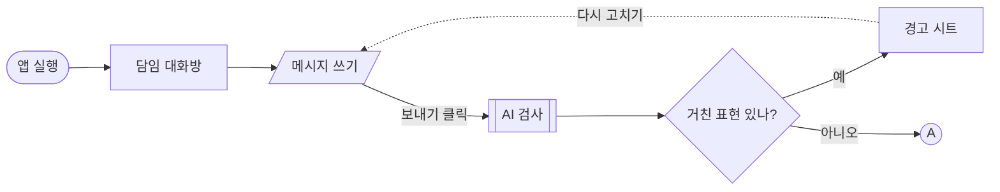

# 유저 플로우 블록 정의

유저 플로우를 그릴 때 쓰는 블록과 선의 뜻을 정한다. 모양 하나에 뜻 하나만 쓴다. 누가 그려도 같은 모양이 같은 뜻이 되도록, 여기 없는 모양은 쓰지 않는다.

## 1. 블록

| 블록 | 모양 | 뜻 | 이름 쓰는 법 | 예 |
|---|---|---|---|---|
| **시작 / 끝** | 둥근 사각형 | 흐름이 시작하거나 끝나는 지점 | 상태나 결과 | 앱 실행, 답장 완료, 끝 |
| **화면** | 사각형 | 사용자가 보는 화면. 시트·팝업도 화면으로 그리고 이름 뒤에 `(시트)`를 붙인다 | 화면 이름 + 화면 번호 | 교사 메시지함 (6-2), 경고 (시트) |
| **사용자 입력** | 평행사변형 | 사용자가 직접 쓰거나 고르는 일 | 동작 | 메시지 쓰기, 학년·반 선택 |
| **시스템 처리** | 양옆에 세로줄이 있는 사각형 | 화면 없이 서버나 AI가 하는 일 | 무엇을 처리하는지 | 이름·연락처 가림, AI 위협 분석 |
| **분기** | 마름모 | 조건에 따라 길이 갈리는 지점 | `?`로 끝나는 질문 | 위협?, 원문 보기 눌렀나? |
| **연결점** | 작은 원 + 글자 | 다른 플로우로 이어지거나 다른 플로우에서 들어오는 지점 | 대문자 한 글자 | Ⓐ, Ⓑ, Ⓒ |

**사용자 입력과 시스템 처리를 나누는 이유:** 하는 주체가 다르다. 사용자 입력은 화면에서 일어나 프론트엔드가 맡고, 시스템 처리는 화면 밖에서 일어나 백엔드가 맡는 경우가 많다. 둘을 나눠 두면 분담표에서 산출물을 나눌 때 그대로 쓸 수 있다.

## 2. 흐름 (화살표)

| 선 | 뜻 | 예 |
|---|---|---|
| **실선 화살표** | 기본 흐름. 다음 단계로 이동 | 메시지 쓰기 → AI 검사 |
| **점선 화살표** | 되돌아가기, 실패, 예외 흐름 | 경고 시트 → 메시지 다시 쓰기, 분석 실패 → 원문 전달 |

- 화살표 위에는 그 이동을 일으키는 **사용자 행동이나 조건**을 적는다. 예: `보내기 클릭`, `5초 넘으면`
- 분기에서 나가는 화살표에는 반드시 `예` / `아니오`(또는 선택지 이름)를 적는다.

## 3. 연결점 규칙

- 한 플로우를 한 장에 다 그리기 어려우면 연결점으로 나눈다.
- 나가는 쪽과 들어오는 쪽에 **같은 글자**를 쓴다. 나가는 원 옆에는 어디로 가는지, 들어오는 원 옆에는 어디서 오는지 적는다.
- 연결점 글자와 뜻은 전체 지도에 한 번 정리한다. 예: `Ⓐ 서버 · Ⓑ 교사 · Ⓒ 관리자`

## 4. 메모

블록은 아니지만, 블록 옆에 **회색 작은 글씨**로 조건이나 규칙을 적는다.

- 숫자나 제한: `5초 넘으면 1번 재시도`
- 이유: `놓치는 것보다 한 번 더 확인하는 게 안전`
- 아직 정해지지 않은 것: `(미정) 위협 원문을 담임도 볼 수 있나?`

## 5. 쓰지 않는 것

| 쓰지 않는 것 | 대신 |
|---|---|
| 팝업·시트·모달 전용 블록 | 화면 블록에 `(시트)` 표시 |
| 데이터베이스(원통) 블록 | 시스템 처리 블록에 "저장"이라고 적음. 예: `원문 시간과 함께 저장` |
| 색으로만 뜻을 구분하기 | 모양으로 구분한다. HTML에서는 `디자인_형식서.md`의 블록 색을 함께 쓰지만, 색은 모양을 돕는 역할이다 |

## 6. Mermaid로 그릴 때

글자로 플로우를 그리는 Mermaid에서는 블록이 아래 문법에 대응한다. GitHub와 노션에서 바로 그림으로 보인다.

| 블록 | Mermaid 문법 |
|---|---|
| 시작 / 끝 | `A([앱 실행])` |
| 화면 | `B[교사 메시지함 6-2]` |
| 사용자 입력 | `C[/메시지 쓰기/]` |
| 시스템 처리 | `D[[AI 위협 분석]]` |
| 분기 | `E{위협?}` |
| 연결점 | `F((A))` |
| 실선 / 점선 | `-->` / `-.->` |

