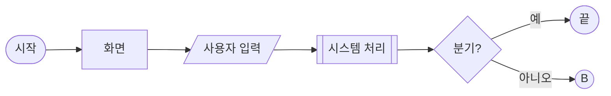
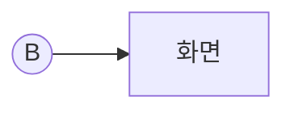
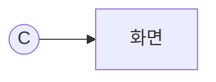

# {서비스 이름} 유저 플로우

## 0. 그리기 전에

블록 모양과 선의 뜻은 `유저플로우_블록정의.md`를 확인하고 그대로 따른다.

**HTML로 뽑을 때:** `디자인_형식서.md`를 따르고, `디자인_컴포넌트.html`의 시작 뼈대에서 시작한다. 이 양식의 섹션은 아래 컴포넌트로 옮긴다. 다이어그램은 FlowKit으로 그리고 `FlowKit.check()`가 빈 배열이 될 때까지 고친다. 참고 구현: `../유저플로우_쿠션톡_261015.html`

| 이 양식 | HTML 컴포넌트 |
|---|---|
| 0. 블록 정의 | LegendCard 8칸 |
| 1. 전체 지도 · 연결점 표 | MapCanvas + DataTable |
| 2. 플로우 (목표 · 관련 화면 · Mermaid · 메모) | FlowCard 하나에 FlowCanvas + MemoList |
| (미정) 메모 | 다이어그램 메모 `o: 1` + OpenList |

## 1. 전체 지도

```text
Ⓐ {누가 · 무엇을}  ── Ⓑ ──▶  Ⓑ {누가 · 무엇을}  ── Ⓒ ──▶  Ⓒ {누가 · 무엇을}
```

| 연결점 | 뜻 |
|---|---|
| Ⓐ | |
| Ⓑ | |
| Ⓒ | |

## 2. 플로우

### Ⓐ {누가} — {무엇을}

- **목표:** {이 플로우가 끝나면 이뤄지는 것}
- **관련 화면:** {화면 번호}



### Ⓑ {누가} — {무엇을}

- **목표:**
- **관련 화면:**



### Ⓒ {누가} — {무엇을}

- **목표:**
- **관련 화면:**


